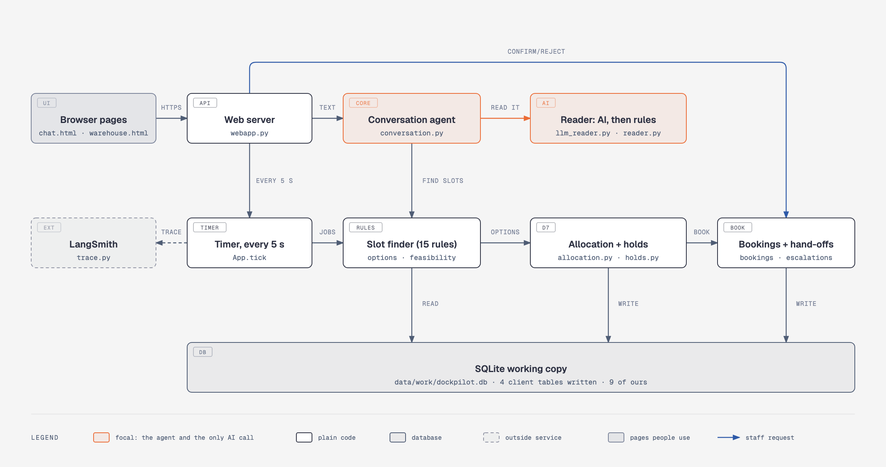

# The code map: how DockPilot connects

One page that shows how every part connects:
- the **picture**
- **four requests followed hop by hop**
- the **data map**

Built from the real code and a real run (fake clock at 09:45, rule reader, fresh working copy, 28 Nov 2026). For the story of one conversation, with real traces, read [04_how_it_works.md](04_how_it_works.md).

Each link points at the line where that function starts. `tests/test_code_map.py` fails if code moves and a link goes stale, and names the link to fix.

---

## 1. The picture

([SVG version](06_code_map.svg), for slides.)

| Box | Files | What it's for |
|---|---|---|
| Browser pages | `static/chat.html`, `static/warehouse.html` | Driver chat; the yard staff's confirm / reject page |
| Web server | `webapp.py` | Routes, cookies, the staff password, starts the timer |
| Conversation agent | `conversation.py` | Decides what to do with each message, and what to say |
| Reader | `llm_reader.py`, `reader.py` | Turns free text into fields. **The only AI call**; the rules take over if the AI fails |
| Slot finder | `options.py`, `feasibility.py` | Which slots fit the truck: 15 rules per slot |
| Allocation + holds | `allocation.py`, `holds.py` | Who gets a contested slot (D7); holds it, one writer at a time |
| Bookings + hand-offs | `bookings.py`, `escalations.py` | Turns a hold into a booking request; hands problems to a coordinator |
| Timer | `webapp.App.tick`, `lifecycle.py` | Every 5 s: expired holds, drift, rush hour, a slow warehouse, silent drivers |
| SQLite working copy | `db.py`, `migrations/` | Everything is stored here; `data/source` is never written |
| LangSmith | `trace.py` | Every request (driver message, warehouse click, timer tick) is recorded as a trace |

---

## 2. Follow one request

**How to read the tables:**
- **In / Out:** what the hop receives and hands back.
- **Database:** rows added (`+1`) or changed (`~`) by this hop, from the real run.
- **Trace step:** the name you'll see in LangSmith (or `python -m dockpilot.trace --last`), so the table and a trace can be read side by side.

### 2a. Driver message: Kailash says "should make it by half past eleven"

The message before was "I am late by one hour.", so the agent is waiting for an arrival time.

| # | Where | In | Out | Database | Trace step |
|---|---|---|---|---|---|
| 1 | [webapp.py:107](../src/dockpilot/webapp.py#L107) `chat_post` | `{"text": …}` + session cookie | calls the agent | — | — |
| 2 | [conversation.py:480](../src/dockpilot/conversation.py#L480) `handle_message` | session id, text | `Reply` (text + state) | `trace_turns` +1, `trace_spans` +9 | **driver message** (the turn) |
| 3 | [auth.py:177](../src/dockpilot/auth.py#L177) `get_session` | session id | driver DRV013, trip SHP1013 (or "log in again") | — | login check |
| 4 | [conversation.py:83](../src/dockpilot/conversation.py#L83) `_resend` | the text | no: not a repeat | — | same message again? |
| 5 | [conversation.py:471](../src/dockpilot/conversation.py#L471) `_read` → [llm_reader.py:92](../src/dockpilot/llm_reader.py#L92) `read_message_ai` | text, time sent | `Reading`: ETA_UPDATE, 11:30, MEDIUM | — | read the message (+ AI model call, when the AI is on) |
| 6 | same, fallback: [reader.py:63](../src/dockpilot/reader.py#L63) `read_message` | text | the rules' `Reading` | — | (note: "rules used") |
| 7 | [conversation.py:345](../src/dockpilot/conversation.py#L345) `_answer_eta` | Reading, "awaiting ETA" | saves the time, then offers slots | `chat_messages` +1 (driver), `eta_updates` +1 | answer to the time question |
| 8 | [conversation.py:157](../src/dockpilot/conversation.py#L157) `_offer` | trip | options, or a hand-off if none fit | — | offer options |
| 9 | [options.py:59](../src/dockpilot/options.py#L59) `find_options` → [feasibility.py:113](../src/dockpilot/feasibility.py#L113) `check_feasibility` | trip, 11:30 | 3 slots that pass all 15 rules: D2 12:00, D4 12:00, D1 13:00 | — | slot search |
| 10 | [allocation.py:85](../src/dockpilot/allocation.py#L85) `request_slot` | best slot (D2 12:00) | normal day → first wins | `slot_requests` +1 | who gets it (D7) |
| 11 | [holds.py:152](../src/dockpilot/holds.py#L152) `place_hold` | slot, request key | hold until 09:55 | `slot_holds` +1, `events` +1 (HOLD_PLACED) | hold the slot |
| 12 | [conversation.py:113](../src/dockpilot/conversation.py#L113) `_finish` | reply text | saves the reply; chat now "awaiting CHOICE" | `chat_messages` +1 (agent) | — |

**The driver sees:** *"You can make D2 12:00–13:00 (held for you until 09:55). Reply 1 to book it, 2 for D4 12:00, 3 for D1 13:00."*

**The messages before and after:**

| Message | Path after `_read` | Database |
|---|---|---|
| "I am late by one hour." (first) | [conversation.py:322](../src/dockpilot/conversation.py#L322) `_fresh` → [conversation.py:284](../src/dockpilot/conversation.py#L284) `_ask_eta`: a delay but no clock time, so ask (R7) | `chat_threads` +1, `chat_messages` +2, `conversation_state` +1 |
| "1" (after) | [conversation.py:361](../src/dockpilot/conversation.py#L361) `_answer_choice` → [bookings.py:50](../src/dockpilot/bookings.py#L50) `convert_hold`: the hold becomes a booking request | `appointments` +1 (pending), `events` +1, `chat_messages` +2, `slot_holds` ~ |

### 2b. Warehouse confirm: the yard staff click Confirm

| # | Where | In | Out | Database | Trace step |
|---|---|---|---|---|---|
| 1 | [webapp.py:157](../src/dockpilot/webapp.py#L157) `warehouse_confirm` | `{"appointment_id": …}` + staff password | `{"told_driver": true}` | `trace_turns` +1, `trace_spans` +3 | **warehouse confirms** (the turn) |
| 2 | [bookings.py:91](../src/dockpilot/bookings.py#L91) `confirm_booking` | appointment id | booking confirmed, with the warehouse's reference | `appointments` ~ (CONFIRMED), `events` +1 | warehouse confirms |
| 3 | [conversation.py:526](../src/dockpilot/conversation.py#L526) `notify_booking_result` | appointment id | posts into the driver's chat | `chat_messages` +1 | tell the driver the warehouse's answer |

### 2c. Timer tick: the first tick of the day

The timer thread [webapp.py:289](../src/dockpilot/webapp.py#L289) `_timer` calls [webapp.py:54](../src/dockpilot/webapp.py#L54) `tick` every 5 s, which runs [webapp.py:63](../src/dockpilot/webapp.py#L63) `_tick` (its jobs, in order). In the real run the first tick found two bookings on a dock that broke (APT1004, APT1005) and rebooked both.

| # | Where | Job | In the run | Database | Trace step |
|---|---|---|---|---|---|
| 1 | [holds.py:131](../src/dockpilot/holds.py#L131) `expire_holds` | Release holds past their time | none due | `slot_holds` ~ when due | expire holds |
| 2 | [lifecycle.py:156](../src/dockpilot/lifecycle.py#L156) `check_drift` → [lifecycle.py:101](../src/dockpilot/lifecycle.py#L101) `handle_dock_event` | Dock events, no-shows, new arrival times recorded outside the chat | 2 bookings rebooked (slot search → hold → booking request each) | `slot_holds` +3, `appointments` +2, `events` +7 | drift check (+ slot search, hold the slot, booking request) |
| 3 | [conversation.py:635](../src/dockpilot/conversation.py#L635) `notify_drift` | Tell drivers whose chat is open and idle | nobody chatting | `chat_messages` +1 per driver told | tell drivers about drift |
| 4 | [allocation.py:110](../src/dockpilot/allocation.py#L110) `settle_requests` → [conversation.py:589](../src/dockpilot/conversation.py#L589) `notify_allocation` | Rush hour: pick the winner after the 30 s window, tell the drivers | no contest | `slot_requests` ~ | settle rush-hour rivals, tell rush-hour drivers who won |
| 5 | [bookings.py:120](../src/dockpilot/bookings.py#L120) `check_warehouse_timeouts` → [conversation.py:609](../src/dockpilot/conversation.py#L609) `notify_warehouse_timeout` | No warehouse answer in 30 min → coordinator, driver told once | none | `escalations` +1 when due | tell drivers: warehouse too slow |
| 6 | [conversation.py:548](../src/dockpilot/conversation.py#L548) `check_silent_drivers` | Nudge after 5 min of silence, close after 10 | none | `chat_messages` +1, `chat_threads` ~ when due | silent drivers (nudge / close) |

All of it is one turn: `trace_turns` +1, `trace_spans` +15 in the run.

### 2d. Login: phone, then code, then a session

Login isn't traced (no trace turn). The `events` table is its diary.

| # | Where | In | Out | Database |
|---|---|---|---|---|
| 1 | [webapp.py:81](../src/dockpilot/webapp.py#L81) `login_start` | `{"phone": "9000010013"}` | `{"demo_sms": code}` (demo) or `{"sent_to": …}` (Cognito) | — |
| 2 | [auth.py:101](../src/dockpilot/auth.py#L101) `request_code` | phone | code sent, or a refusal reason | `login_codes` +1, `events` +1 (LOGIN_CODE_SENT) |
| 3 | [auth.py:86](../src/dockpilot/auth.py#L86) `active_trips` | driver id | trips in progress (a driver with none is refused here, before any code) | — |
| 4 | [webapp.py:94](../src/dockpilot/webapp.py#L94) `login_verify` | phone, code | greeting + trips, session cookie (HttpOnly, 12 h) | — |
| 5 | [auth.py:132](../src/dockpilot/auth.py#L132) `verify_code` | phone, code | session, or "Wrong code. N tries left." | `driver_sessions` +1, `login_codes` ~, `events` +1 (LOGIN_OK) |

With `AUTH_MODE=cognito`, steps 2 and 5 also call [cognito.py](../src/dockpilot/cognito.py). It's parked for now: AWS blocks Cognito in our account.

---

## 3. The data map

**Ours:** 9 tables, created by `migrations/`.

| Table | Written by | Read by | What it holds |
|---|---|---|---|
| `slot_requests` | allocation | allocation | Each request for a slot, and how D7 decided it |
| `slot_holds` | holds, bookings | holds, allocation, feasibility, conversation, lifecycle, bookings | Short holds on slots ("held until 09:55") |
| `escalations` | escalations | escalations, webapp (warehouse page) | Coordinator hand-offs and their reason |
| `events` | auth, holds, bookings, escalations, lifecycle | lifecycle | The diary: every login, hold, booking, hand-off |
| `login_codes` | auth | auth | Code hashes and tries (in Cognito mode: a marker and Cognito's session) |
| `driver_sessions` | auth, conversation | auth | 12-hour sessions and the chosen trip |
| `conversation_state` | conversation | conversation | What each chat is waiting for (ETA, CHOICE, WAREHOUSE…) |
| `trace_turns`, `trace_spans` | trace | trace | Local traces (when tracing is on) |

**The client's:** 4 tables we write to, in the working copy only.

| Table | Written by | Read by | What we write |
|---|---|---|---|
| `appointments` | bookings, lifecycle | most modules | New booking requests; confirm / reject; no-shows |
| `chat_threads` | conversation | conversation, escalations | DockPilot's own `DPT-` threads |
| `chat_messages` | conversation | conversation, webapp | Every driver and agent message |
| `eta_updates` | conversation | feasibility, lifecycle | Arrival times the driver gave (`ETA_DP-` rows) |

All other client tables (docks, slots, shipments, drivers, dock events…) are **read only**. The original database in `data/source` is never opened for writing: `db.init_work_db` copies it to `data/work/` first.
